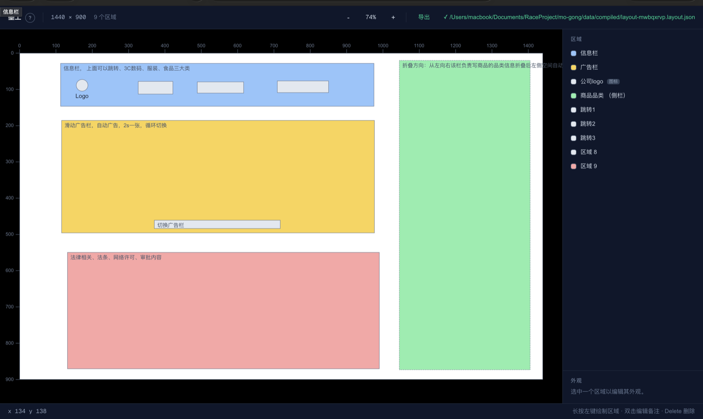
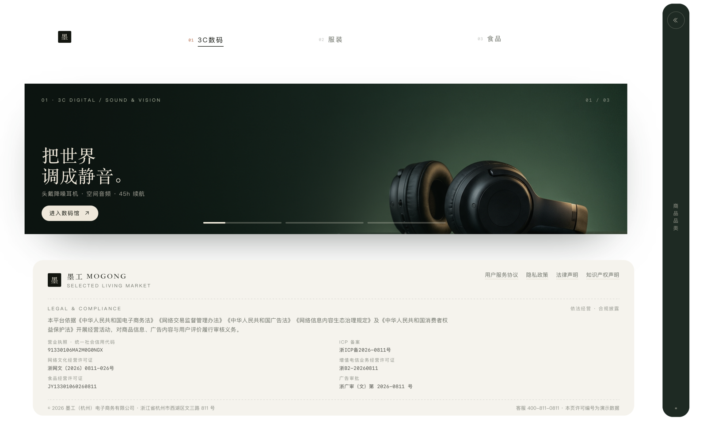
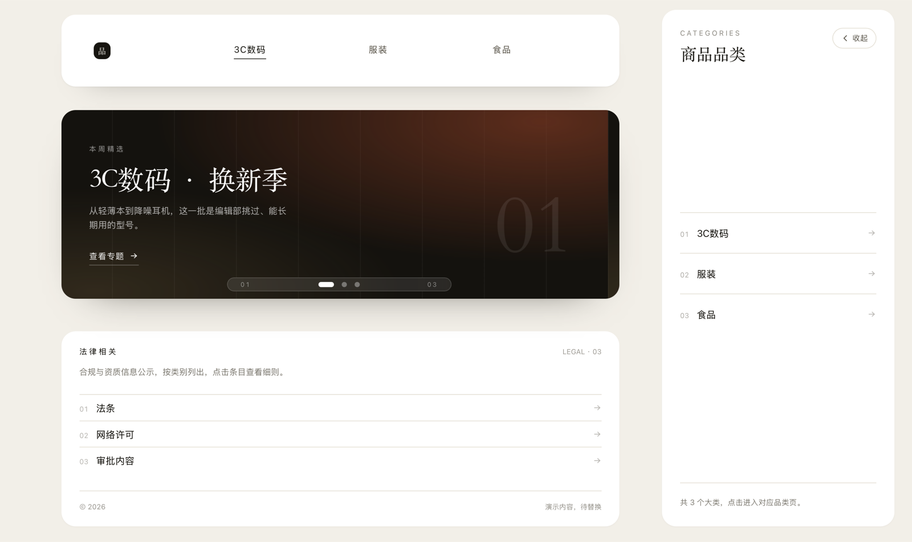

# MoGong (墨工)

**A visual intent compiler** — draw a layout on a canvas, compile it into JSON an AI agent can execute exactly.

Tell an AI "make the header a bit taller, give the sidebar a small strip on the left" and it can only guess.
Draw it in MoGong and it follows. Draw rectangles, annotate them, set colors and nesting, hit export, and you
get a `*.layout.json` that describes the relationships in the layout.

Try it online: <https://mogong-5cbrebyyovl.qoder.zone>

[English](README.md) | [简体中文](docs/README.zh-CN.md)

[](https://mogong-5cbrebyyovl.qoder.zone)

## What you get

The same layout JSON, handed to an agent, can land the same front layout.






## Usage

1. Draw rectangles on the canvas and give each one a name a human would use ("product category sidebar", not
   "rectangle 3"); double-click to write a note
2. Click **Export** in the toolbar to get `*.layout.json`
3. Hand the JSON to an agent together with the Skill

The JSON is a **mould, not a finished spec**: it constrains the relationships between regions — what contains
what, what comes first, how much space each one takes, how much gap is left. How components are split, which
library they use, and how they are colored is up to your prompt and the agent's design judgment.

## Quick start

```bash
make dev     # backend on :8100 + frontend on :3000, open http://localhost:3000
make sites   # build the static version (compiles in the browser via Pyodide, no backend)
make test    # frontend and backend tests
make help    # every target
```

Requirements: Python 3.11+, Node.js 20+.

### Docker

```bash
docker compose up --build
# open http://localhost:3000 (the backend API is on :8100)
```

Canvas data lives in a volume named `mogong-data`, which survives `docker compose down`; use
`docker compose down -v` to drop the data as well.

## Skill package

- Download `mogong-layout-skill-*.zip` from [GitHub Releases](https://github.com/Linson1129/MoGong/releases),
  or use **Download Skill package** in the editor toolbar
- Unzip and drop `mogong-layout/` into your client's skills directory. Clients that only accept prompts can
  take the full `SKILL.md` pasted alongside the JSON instead
- Inside Qoder, opening this project also lets you invoke `/mogong-layout` directly

## Contributing

These are the things we haven't built yet, and they make good places to start:

| Area | Where it stands |
|------|-----------------|
| Mobile layout | The editor is designed for a desktop mouse and keyboard; there is no usable path on narrow or touch screens |
| Multiple windows | One document holds a single sheet — there is no way to compare canvases side by side or share a set of regions between them |
| UI language switching | All copy is Chinese and written inline in components; there is no i18n layer yet |

Anything else you spot is welcome too. The flow: fork, create a branch, run `make test` and `make lint`, then
open a PR against `main`. Small, focused PRs are the easiest to review; if you want to align on a larger
change first, open an issue.

Note that the documents under [`docs/`](docs) are written in Chinese.

## Project structure

```
mo-gong/
├── frontend/                  # Next.js editor (canvas, panels, export)
│   └── src/
│       ├── components/        # canvas / layout / panel
│       ├── lib/               # geometry, gestures, compile engine, export
│       └── stores/            # Zustand: document, view, interaction, theme, history
├── backend/                   # FastAPI + Pydantic, the compiler itself (one Python implementation)
│   └── app/
│       ├── routers/           # compile / validate / layouts
│       └── services/          # nesting, layout/role/spacing inference, validation
├── .qoder/skills/
│   └── mogong-layout/         # the Skill that hands compiled output to an agent
├── docs/                      # spec / architecture / json-schema / dev-guide
├── fixtures/cases/            # geometry truth tables shared by frontend and backend
└── scripts/                   # dev / smoke / packaging scripts
```

## Tech stack

| Layer | Choice |
|-------|--------|
| Frontend | Next.js 16 + React 19 + Zustand + Tailwind CSS 4 + SVG |
| Backend | Python 3.12 + FastAPI + Pydantic v2 |
| In-browser compile | Pyodide (the same Python compiler, running in WASM) |
| Tests | Vitest (frontend) + pytest (backend) |

## License

[MIT](LICENSE) © 2026 Linson1129
