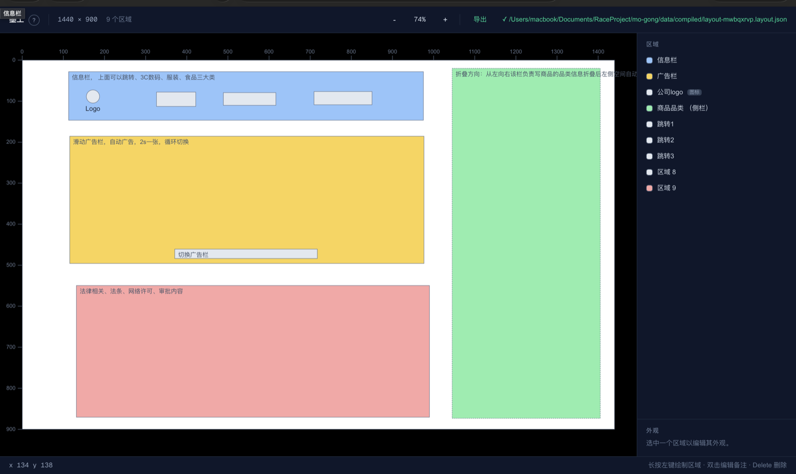
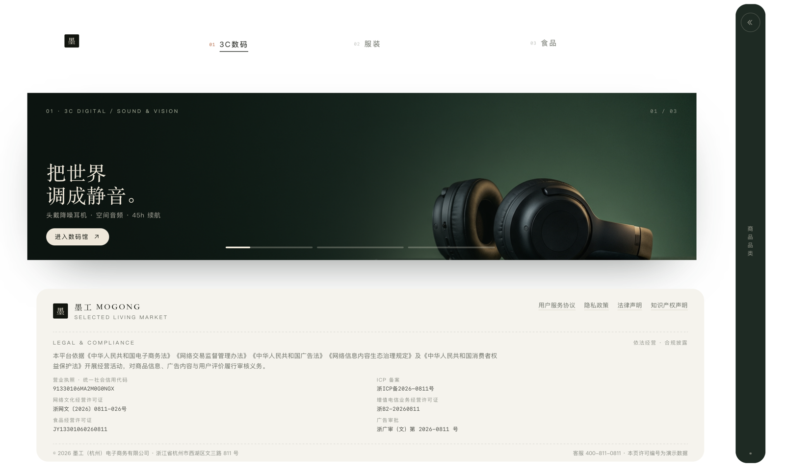
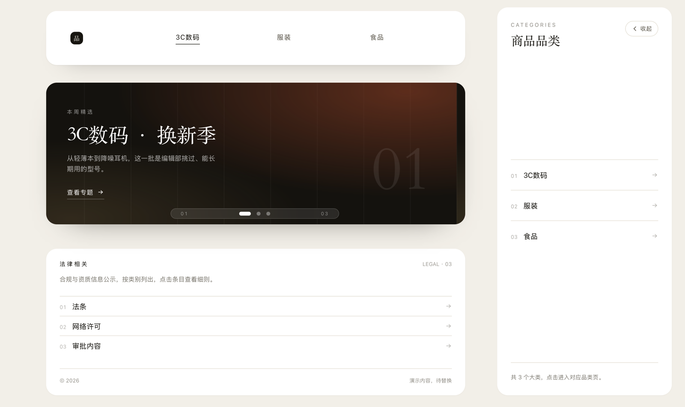

# 墨工 (MoGong)

**视觉意图编译器** — 在画布上画出布局，编译成 AI Agent 能精确执行的 JSON。

跟 AI 说「header 高一点、sidebar 占左边一小块」，它只能猜；在墨工里画出来，它就照着做。
画矩形、写备注、调颜色和嵌套关系，点一下导出，得到一份描述布局关系的 `*.layout.json`。

在线试用：<https://mogong-5cbrebyyovl.qoder.zone>

[English](../README.md) | 简体中文

[](https://mogong-5cbrebyyovl.qoder.zone)

## 效果

同一份布局 JSON，交给 Agent 后可以落地成完全不同的设计方向：

深色方向：



浅色方向：



## 怎么用

1. 在画布上画矩形，给每块起个像人话的名字（「商品品类侧栏」而不是「矩形 3」），双击写备注
2. 点工具栏「导出」，得到 `*.layout.json`
3. 把 JSON 和 Skill 一起交给 Agent

JSON 是**模具，不是成品**：它约束区域之间的关系——谁包含谁、先后顺序、各占多少比例、留了多少空隙；
组件怎么拆分、用什么库、怎么配色，由你的 prompt 和 Agent 的设计判断决定。

## 快速开始

```bash
make dev     # 后端 :8100 + 前端 :3000，打开 http://localhost:3000
make sites   # 构建纯静态版（浏览器内 Pyodide 编译，无需后端）
make test    # 前后端测试
make help    # 全部目标
```

环境要求：Python 3.11+、Node.js 20+。

### Docker

```bash
docker compose up --build
# 打开 http://localhost:3000（后端 API 在 :8100）
```

画布数据保存在名为 `mogong-data` 的卷里，`docker compose down` 不会删除；要连数据一起清掉用 `docker compose down -v`。

## Skill 包

- 下载：[GitHub Releases](https://github.com/Linson1129/MoGong/releases) 中的 `mogong-layout-skill-*.zip`，或编辑器工具栏的「下载 Skill 包」
- 解压后把 `mogong-layout/` 放进客户端的 skills 目录；只吃 prompt 的客户端，把 `SKILL.md` 全文和 JSON 一起粘贴即可
- 在 Qoder 中打开本项目，也可直接 `/mogong-layout` 调用

## 欢迎 PR

下面几件事我们还没做，也正好是合适的入手点：

| 方向 | 现状 |
|------|------|
| 移动端布局 | 编辑器按桌面鼠标 + 键盘设计，窄屏或触屏下没有可用的操作路径 |
| 多窗口设计 | 一份文档只有一张纸面，没法并排比较两块画布，也没法让多张画布共用一批区域 |
| 界面语言切换 | 文案目前全是中文且直接写在组件里，没有 i18n 层 |

这之外任何改进都欢迎。流程：fork → 新建分支 → 跑 `make test` 与 `make lint` → 向 `main` 提 PR。
改动越小越容易 review；大改之前想先对齐方向，可以先开 Issue。

## 项目结构

```
mo-gong/
├── frontend/                  # Next.js 编辑器（画布、面板、导出）
│   └── src/
│       ├── components/        # canvas / layout / panel
│       ├── lib/               # 几何、手势、编译引擎、导出
│       └── stores/            # Zustand：文档、视图、交互、主题、历史
├── backend/                   # FastAPI + Pydantic，编译器本体（仅 Python 一份实现）
│   └── app/
│       ├── routers/           # compile / validate / layouts
│       └── services/          # 嵌套、布局/角色/间距推断、校验
├── .qoder/skills/
│   └── mogong-layout/         # 把编译产物交给 Agent 的 Skill
├── docs/                      # spec / architecture / json-schema / dev-guide
├── fixtures/cases/            # 前后端共享的几何真值表
└── scripts/                   # dev / smoke / 打包脚本
```

## 技术栈

| 层 | 选型 |
|----|------|
| 前端 | Next.js 16 + React 19 + Zustand + Tailwind CSS 4 + SVG |
| 后端 | Python 3.12 + FastAPI + Pydantic v2 |
| 浏览器编译 | Pyodide（同一份 Python 编译器在 WASM 里运行） |
| 测试 | Vitest（前端）+ pytest（后端） |

## License

[MIT](../LICENSE) © 2026 Linson1129
