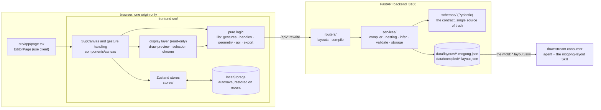
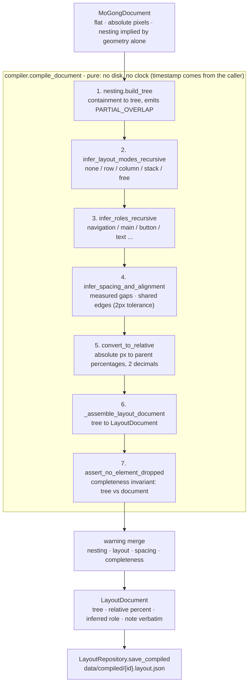
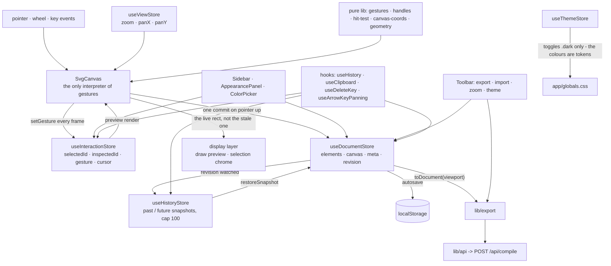
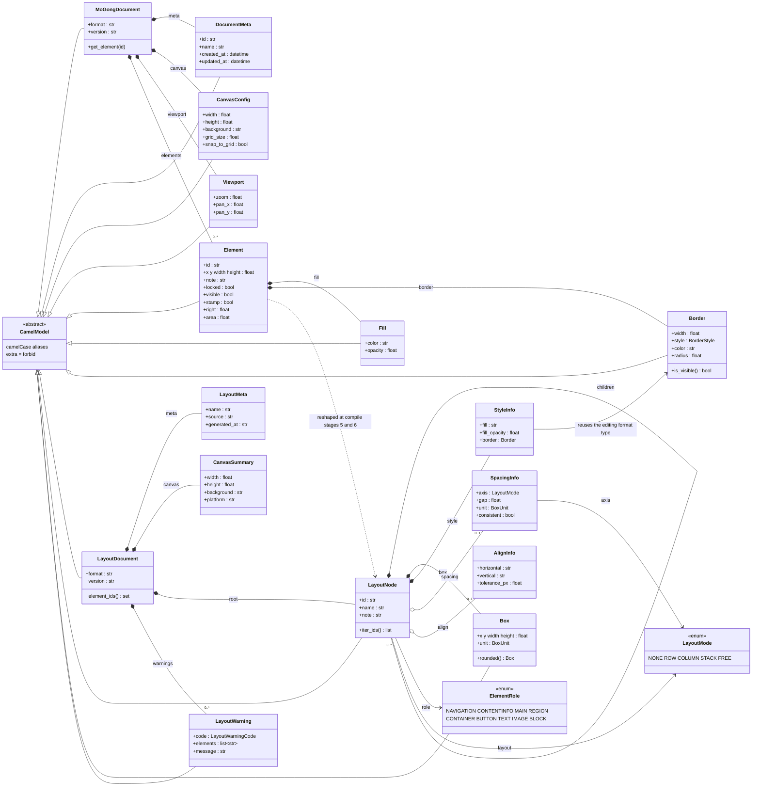
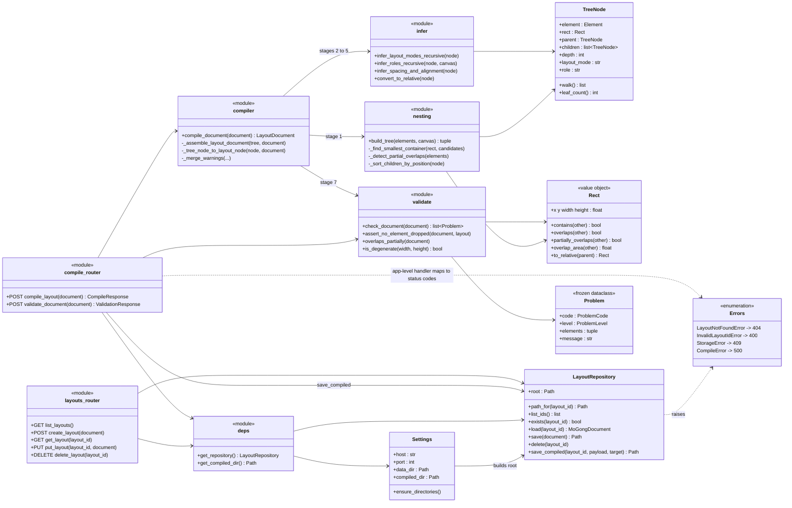
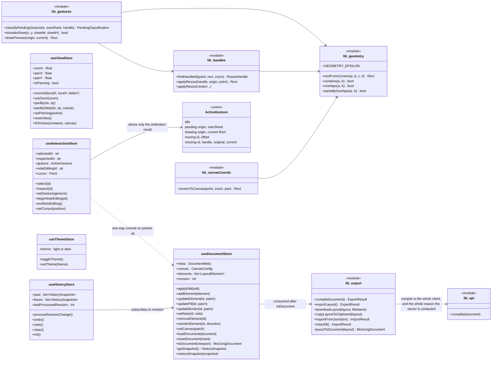
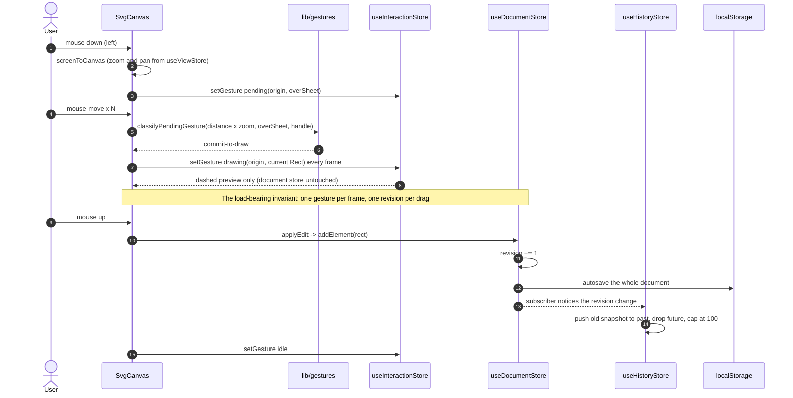
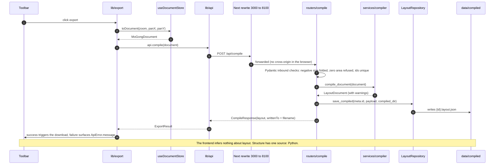
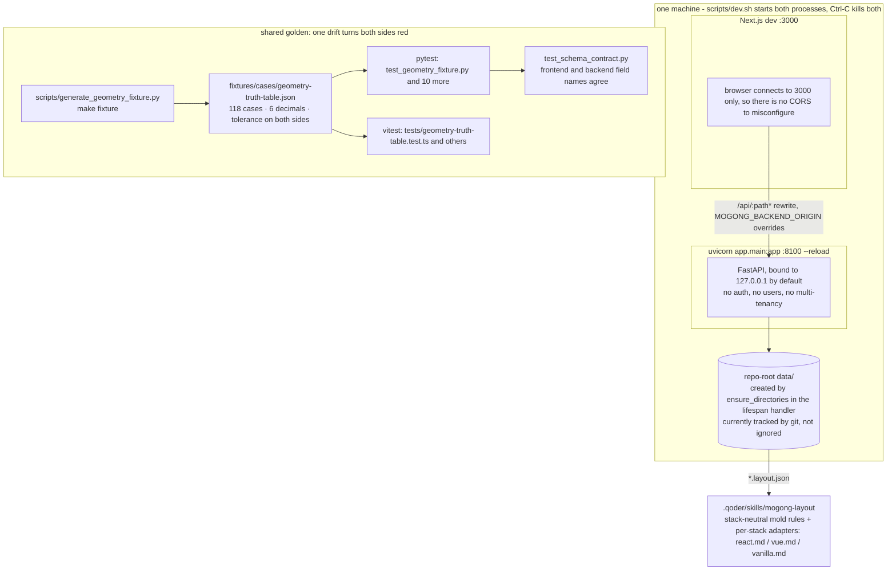

# MoGong Diagrams

Version: v0.2
Role: pictures of the code as it stands. Every node and edge was read off the source rather than
redrawn from `docs/architecture.md`; where the two disagreed, architecture.md was corrected.

Chinese appears below only where it is the literal UI string or real data (e.g. `商品品类`).

The **display layer** is everything drawn over the rectangles that is not itself part of an
artifact: the dashed draw preview, the selection chrome. It reads state and
writes none. It used to carry an **annotation layer** as well - dimension rules, gap readouts and a
selection pill computed by `frontend/src/lib/annotations.ts`. That layer is deleted and the file no
longer exists: the numbers an agent must honour live in the artifact, and recomputing them every
frame was what made dragging feel heavy.

| # | Diagram | Question it answers |
|---|---------|---------------------|
| 1 | System overview | what runs where, and who owns the truth |
| 2 | Compile pipeline | how pixels become agent-readable intent |
| 3 | Frontend layers and update rates | why one drag does not produce sixty undo entries |
| 4 | Contract layer (UML) | the two JSON formats and the types they share |
| 5 | Backend collaboration (UML) | which module may call which |
| 6 | Frontend stores (UML) | state ownership, store by store |
| 7 | Sequence: drawing a rectangle | the frame-by-frame path from pointer down to commit |
| 8 | Sequence: exporting layout.json | the only cross-process path in the product |
| 9 | State machine: gesture arbitration | where the motion threshold lives |
| 10 | Dev runtime and shared test contract | how it starts, and what keeps both sides honest |

Rule for keeping this file true: a box with no file behind it does not belong in it.

---

## 1. System overview



The document store, not the backend, is what the editor renders from; the backend is what the
exported file is computed by. That is why `data/` survives a browser refresh but a crash before
export costs nothing more than the autosave interval.

## 2. Compile pipeline



Stages 2 to 5 mutate the `TreeNode` in place; only stage 6 crosses into Pydantic. That ordering is
what keeps the pipeline testable without a filesystem, and it is why a compile has no I/O to mock.

## 3. Frontend layers and update rates



Three rates, deliberately separated: per frame (interaction), per edit (document, history,
autosave), per wheel tick (view). A frame costs one gesture write and one re-render of what the
gesture already holds; nothing in the render path walks the parent chain or measures siblings.

## 4. Contract layer (UML)

Two formats, deliberately not one: the editor's flat absolute-pixel document, and the compiled
tree of parent-relative percentages. `Border` is shared, which is the only place the two touch.



`extra = forbid` on every model is what makes the schema a contract rather than a hint: a field the
frontend invents fails the request instead of being silently dropped on the way to the agent.

## 5. Backend collaboration (UML)



Only the routers touch HTTP, and only `LayoutRepository` touches the disk. `compiler`, `nesting`,
`infer` and `validate` are pure, which is why the whole pipeline runs under pytest with no fixtures
on disk and no server.

## 6. Frontend stores (UML)



`lib_geometry` has exactly one consumer side left: the truth table and its own unit tests. Nothing in
the frontend recomputes the percentages the compiler will report any more, so `PERCENT_PRECISION` lives
only in `backend/app/schemas/layout.py` - the hand-written frontend copy went away with the last readout
that could have needed it, rather than being kept as a number nothing reads.

## 7. Sequence: drawing a rectangle



## 8. Sequence: exporting layout.json



## 9. State machine: gesture arbitration

```mermaid
stateDiagram-v2
  [*] --> idle
  idle --> pending : left button down on the sheet, records origin and overSheet
  idle --> resizing : press lands on a resize handle (the one gesture needing no arbitration)
  idle --> panning : middle button down, or left button released after a drag started off the sheet
  pending --> drawing : travelled over 3 screen pixels with the press on the sheet (commit-to-draw)
  pending --> panning : travelled over 3 screen pixels with the press off the sheet (start-panning)
  pending --> click : released under the threshold
  pending --> resizing : a handle turns out to be under the cursor
  click --> idle : select, or deselect when the press missed every element
  drawing --> idle : pointer up commits addElement
  moving --> idle : pointer up commits updateElement
  resizing --> idle : pointer up commits updateElement
  panning --> idle : any button released
  idle --> noteEditing : double click (beginNoteEditing)
  drawing --> noteEditing : double click
  noteEditing --> idle : save or Escape (endNoteEditing, canvas gestures suspended)
  note left of pending
    No state here waits on a clock. The union has no panning member either: panning is viewport
    state in useViewStore.isPanning, drawn here because that is where the user meets it.
    Moving a region is Alt+drag and never enters this arbitration at all.
  end note
```

## 10. Dev runtime and the shared test contract



---

## What these diagrams are asserting

- **One compile path.** Diagram 8 is the only route from a drawing to layout JSON. The moment a
  second one exists in TypeScript, diagram 3's clean split becomes a drift risk instead of a design.
- **One revision per drag.** Diagram 7's middle note is the reason undo is usable.
- **Display never edits.** The draw preview and the selection chrome read gesture state and write
  none. That is what keeps a per-frame render honest: it cannot change what it appears to measure.
- **The mold is the deliverable.** Diagram 1's last edge is the product; everything before it is
  machinery to make that edge honest.

## Known gaps these diagrams expose

| Gap | Where it shows | Status |
|-----|----------------|--------|
| `/api/layouts` CRUD and `POST /api/compile/validate` are implemented, reachable over HTTP, and called by nothing in the editor; persistence is localStorage and validation arrives inside the compiled artifact. The frontend client no longer carries a method for either, so the gap is visible instead of implied by an unused API surface | 1, 6, 8 | open, harmless for MVP; revisit if the tool goes multi-user |
| A live validation readout in the editor is specified nowhere and built by nothing; `/api/compile/validate` exists for it and is used only by the smoke test | 8 | open, and `compile.py` says so rather than claiming the editor calls it |
| `CompileError -> 500` sits oddly beside "the compiler is pure": a pure function should have no raisable path | 5 | worth auditing which branch can trigger it |
| `data/` is tracked by git while architecture.md claimed it was ignored | 10 | fixed for real on 2026-11-12: `data/` is in .gitignore and the two committed sample drawings were removed from the index |
| Fixtures pin geometry, not compiled output; there is no artifact-level parity between the two languages | 10 | by design until a TS compiler exists |
